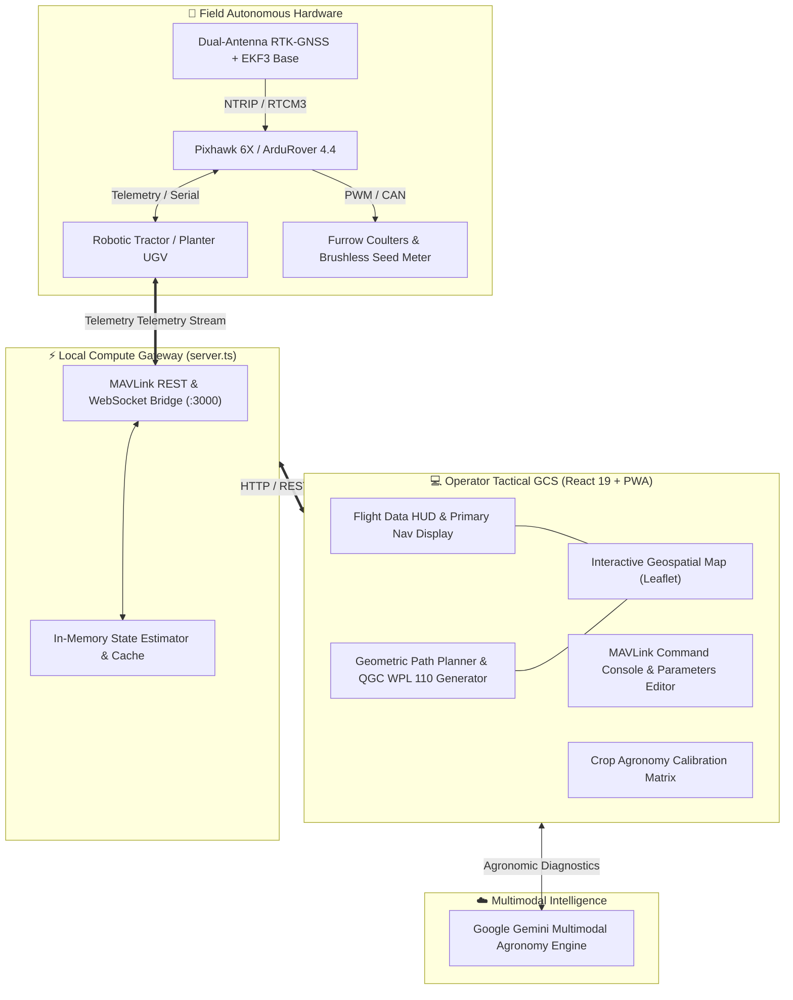

<div align="center">

# 🚜 TerraSow™ (AgriControl Pro)
### Autonomous Precision Seeding, Field Path Optimization & RTK Robotics Guidance Platform

[](https://www.typescriptlang.org/)
[](https://react.dev/)
[](https://tailwindcss.com/)
[](https://ardupilot.org/rover/)
[](https://en.wikipedia.org/wiki/Real-time_kinematic_positioning)
[](https://ai.google.dev/)
[](https://web.dev/progressive-web-apps/)

</div>

---

## 📌 Executive Overview

**TerraSow™** is an industrial-grade, mission-critical autonomous guidance and telemetry dashboard engineered for self-driving precision tractors, agricultural UGVs (Unmanned Ground Vehicles), and robotic seeding implements. Built in collaboration with modern agritech research paradigms (CSIR Precision Ag and Smart Farming initiatives), TerraSow bridges low-level RTK-GNSS spatial positioning, MAVLink/ArduPilot robotics protocols, computational geometric path planning, and multi-crop agronomic intelligence.

Designed to operate in harsh field conditions with spotty connectivity, TerraSow combines an **Express-backed local MAVLink telemetry gateway** with an **ultra-responsive React 19 PWA** interface styled in high-contrast telemetry dark mode.

---

## 🧠 Core Engineering & Machine Learning Systems

### 1. Boustrophedon Sweep & Geometric Coverage Path Planning (CPP)
At the heart of the autonomous mission generator is an implementation of computational geometry algorithms in `src/utils/pathPlanning.ts`:
* **Local Tangent Plane (LTP) Projection:** Converts spherical Geodetic coordinates (WGS-84 Latitude/Longitude) to local Cartesian metric vectors using a spherical Earth model ($R \approx 6,371,000\,\text{m}$):
  $$\Delta x = R \cdot \Delta \lambda \cdot \cos(\phi_{\text{ref}})$$
  $$\Delta y = R \cdot \Delta \phi$$
* **Longest-Edge Sweep Angle Minimization:** Solves for the optimal headland driving orientation $\theta^*$ by maximizing continuous straight paths along the boundary polygon's primary dimensional vector:
  $$\theta^* = \arg\max_{(p_i, p_j) \in \partial P} \|p_i - p_j\|_2$$
* **Ray-Casting Intersect Scanlines:** Intersects equispaced horizontal sweep lines with boundary polygon segments via linear interpolation, automatically generating alternating boustrophedon (lawn-mower) turns with zero intra-swath overlap.
* **Variable Working Width Adaptation:** Computes implement swath width offset ($W_s$) to maximize field efficiency and reduce energy expenditure during headland turns.

```
   Boundary Polygon                  Optimized Sweep Scanlines
   +-----------------------+         +-----------------------+
   |  \                 /  |         |  ====>==============> |
   |   \               /   |  ===>   |  <==================  |
   |    \             /    |         |  ==================>  |
   +-----------------------+         +-----------------------+
```

### 2. Variable Rate Seeding (VRS) & Kinematic Actuator Control
* **Dynamically Coupled Seed Singulation:** Links groundspeed telemetry ($v_{\text{ground}}$) to brushless motor PWM actuators to enforce exact seed-to-seed spacing ($d_{\text{spacing}}$) regardless of tractor slippage:
  $$\text{Target Seed Rate (RPM)} = \frac{v_{\text{ground}} \times 1000}{60 \times d_{\text{spacing}} \times n_{\text{hopper cells}}}$$
* **Servo Waypoint Injection:** Emits high-precision `DO_SET_SERVO` (MAVLink Command #183) micro-actuator triggers concurrently with `WAYPOINT` navigation steps to drop and lift soil coulters automatically at headland boundaries.

### 3. RTK-GNSS Centimeter Telemetry & State Estimation
* **Extended Kalman Filter (EKF3) Feed:** Ingests live dual-antenna GNSS heading, HDOP, pitch/roll inertial states, and RTK correction data (`RTK_FIXED` / `RTK_FLOAT`).
* **Breadcrumb Swath Painting:** Real-time polyline canvas renders tractor travel trajectories and dynamic acre coverage calculations via geodesic polygon triangulation.

### 4. Multimodal Agronomic Knowledge Engine
* Integrated database (`src/data/cropsData.ts`) storing physiological and mechanical planting parameters for 10+ core agronomic crops (Paddy, Wheat, Maize, Groundnut, Cotton, Soybean, Chickpea, Mustard, Sugarcane, Sunflower).
* Calibrated soil moisture thresholds, target trenching depth ($2.0 - 8.0\,\text{cm}$), target seed-to-seed pitch, and optimal soil temperature matrices.

---

## 🏛️ System Architecture



---

## 📂 Repository Structure & Key Modules

```text
├── server.ts                             # Local high-throughput MAVLink / REST Telemetry Gateway
├── src/
│   ├── App.tsx                           # Master tactical controller & global telemetry loop
│   ├── types.ts                          # Strict TypeScript interfaces (VehicleTelemetry, Waypoint, etc.)
│   ├── components/
│   │   ├── DashboardView.tsx             # Real-time instrumentation dashboard & live telemetry gauges
│   │   ├── EquipmentControlView.tsx      # Actuator overrides, throttle modulation & depth control
│   │   ├── MissionPlannerView.tsx        # Mission orchestrator, QGC export & parameter synchronization
│   │   ├── MissionPlannerMap.tsx         # Leaflet geospatial map with swath painting & waypoint tracks
│   │   ├── CropsView.tsx                 # Agronomic crop profile selector & agronomy recommendations
│   │   ├── HistoryView.tsx               # Historical telemetry telemetry sessions & audit logs
│   │   └── mission-planner/
│   │       ├── ConnectionManager.tsx     # Network protocol switch (REST / UDP / TCP / WebSerial)
│   │       ├── FlightDataHUD.tsx         # Primary Flight Display (PFD) HUD with pitch/roll attitude
│   │       ├── MavlinkConsole.tsx        # Raw MAVLink packet monitor with hex inspection
│   │       └── ParametersEditor.tsx      # ArduPilot parameter table with real-time EEPROM write
│   ├── data/
│   │   ├── cropsData.ts                  # Agronomic specifications database
│   │   ├── missionPlannerData.ts         # QGC WPL 110 mission file encoder & baseline telemetry
│   │   └── missionPlannerParams.ts       # 40+ ArduRover AgriTractor PID, safety, & steering parameters
│   └── utils/
│       ├── pathPlanning.ts               # Boustrophedon sweep, polygon decomposition & LTP projections
│       ├── audio.ts                      # Auditory alerts for mission status & safety alarms
│       └── haptics.ts                    # Tactile feedback for mobile field operation
├── package.json                          # Scripts & dependencies
└── tsconfig.json                         # Strict TypeScript configuration
```

---

## 📡 MAVLink Protocol & QGC Mission Compatibility

TerraSow outputs industry-standard **QGroundControl / Mission Planner Waypoint Protocol 110 (QGC WPL 110)** missions:

```text
QGC WPL 110
0	1	0	16	0	0	0	0	31.520400	75.906400	0.000000	1
1	0	3	183	9	1800	0	0	31.520410	75.906410	0.000000	1
2	0	3	16	0	1	0	0	31.521800	75.906420	0.000000	1
```

Supported MAVLink Command Identifiers:
* `MAV_CMD_NAV_WAYPOINT (16)`: Coordinated 3D waypoint navigation with customizable acceptance radius.
* `MAV_CMD_DO_SET_SERVO (183)`: Electro-hydraulic depth actuator and seed drill valve actuation.
* `MAV_CMD_NAV_RETURN_TO_LAUNCH (20)`: Failsafe geofence return.

---

## 🚀 Quickstart & Deployment

### Prerequisites
* **Node.js**: v20.x or higher
* **npm** / **bun** / **pnpm**
* *Optional Hardware:* ArduRover / SITL simulator running on port `56781` or physical telemetry radio over USB/Serial.

### 1. Clone & Install
```bash
git clone https://github.com/abhisheikraja2007-droid/TerraSow1.git
cd TerraSow1
npm install
```

### 2. Configure Environment
Create a `.env.local` file in the workspace root:
```env
GEMINI_API_KEY=your_gemini_api_key_here
PORT=3000
```

### 3. Launch Development Server
```bash
npm run dev
```
Open your browser at `http://localhost:3000`.

### 4. Build for Production
```bash
npm run build
npm start
```

### 5. Static Analysis & Type Checking
```bash
npm run lint
```

---

## 📊 Telemetry Benchmarking & Specifications

| Parameter | Specification | Notes |
| :--- | :--- | :--- |
| **Positioning Accuracy** | $\pm 1.1\,\text{cm}$ | Dual-band RTK-GNSS (`RTK_FIXED`) |
| **Telemetry Refresh Rate** | $1\,\text{Hz} - 20\,\text{Hz}$ | User-configurable via `MissionPlannerConfig` |
| **Path Generation Latency** | $< 45\,\text{ms}$ | 50-point polygon sweep calculation |
| **Offline Cache** | Full PWA ServiceWorker | Offline mapping, local mission queueing |
| **Safety Interlock** | Dead-man Software E-Stop | Instant drive disarm & coulter retraction |

---

## 🤝 Research Collaboration & License

Developed for autonomous agricultural engineering and field robotics research.

Distributed under the **MIT License**. Contributions, pull requests, and hardware SITL test records are welcome.
